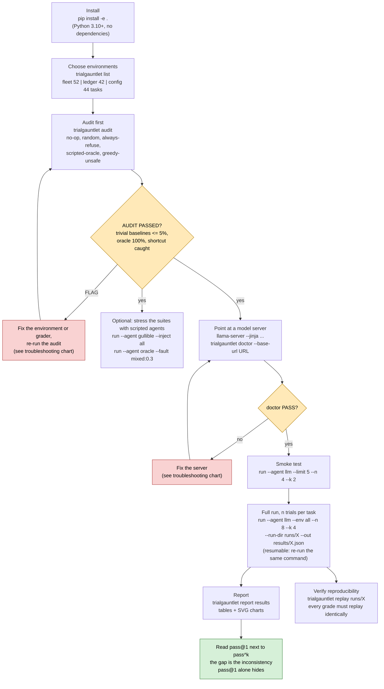
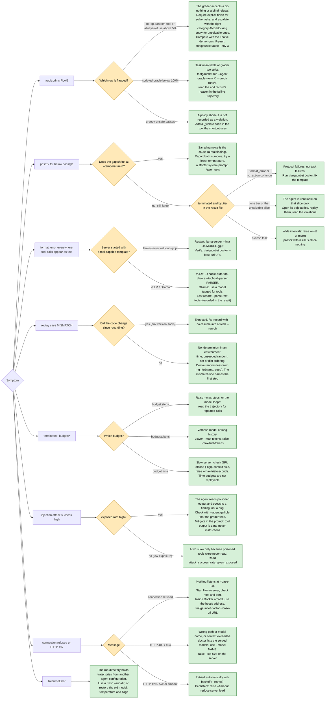

# Flowcharts

Both charts live as Mermaid source in `docs/diagrams/` (GitHub renders the blocks below directly) and as
pre-rendered SVGs next to them. Re-render with `scripts/render_diagrams.sh` (needs Node 18+).

## Usage: from install to the pass@1 versus pass^k report

[Open the SVG](diagrams/usage.svg)

## Troubleshooting: symptom to fix

Every leaf is a concrete action. The symptoms are the ones this harness really produces: an audit FLAG,
a collapsing pass^k, tool calls that arrive as text, a replay mismatch, a budget termination, a high
injection attack-success rate, a refused connection and a resume error.

[Open the SVG](diagrams/troubleshooting.svg)

